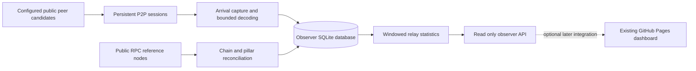

# Zenon P2P Observer implementation specification

Version 1.0 · November 7, 2026 · Status: ready for a separate implementation project

## Purpose and boundaries

Build an independent service that maintains a small set of persistent Zenon P2P connections and records which peers announce or deliver each momentum, when they do so, and which software version they advertise. Use repeated observations to investigate associations between pillar producers and relay peers.

Deploy this service as a new Coolify application with its own repository, P2P identity, storage, and lifecycle. The existing Zenon Observatory and discovery API must continue operating independently. The user will create the new project and perform Coolify deployment.

The primary output is a table of **pillar → observed relay peer → IP → advertised version**, with sample counts, timing, coverage, and evidence. A relay association must never silently become a claim that the IP belongs to the pillar or that the pillar runs that version.

Initial scope is one observer with four outbound connections and a 24–48 hour pilot. Connection counts, storage, and traffic must remain bounded. No full-chain synchronization, validator operation, wallet access, automated ownership claims, or changes to the existing application are included.

Suggested new repository name: `zenon-p2p-observer`. Existing project references are the [Observatory repository](https://github.com/0x3639/go-zenon-version), [live dashboard](https://0x3639.com/go-zenon-version/), and [optional public candidate feed](https://tw7v2v7y9rjq7mle1isnlktq.172.245.238.165.sslip.io/api/v1/nodes). These are reference inputs, not deployment targets for this project.

## Protocol facts that shape the implementation

The pinned go-zenon revision is `bb39e31c608dc397a91b98b21b096bca99a9f4d6`, corresponding to the dependency used by the existing Observatory. Pin dependencies and record the resolved source revision in every build. Review compatibility before upgrading.

A momentum contains an Ed25519 signing public key and signature; its producer address derives from that key. Its numeric `version` field is not a go-zenon release identifier. Software names and peer identity come from the separate P2P handshake. [Momentum definition](https://github.com/zenon-network/go-zenon/blob/bb39e31c608dc397a91b98b21b096bca99a9f4d6/chain/nom/momentum.go), [producer implementation](https://github.com/zenon-network/go-zenon/blob/bb39e31c608dc397a91b98b21b096bca99a9f4d6/pillar/worker_momentum.go), [P2P handshake](https://github.com/zenon-network/go-zenon/blob/bb39e31c608dc397a91b98b21b096bca99a9f4d6/p2p/peer.go).

The pinned implementation negotiates the `eth/61` capability with Zenon-specific payloads. Its status exchange checks protocol version, network ID, and genesis hash. The field called `TD` carries momentum height. An RLPx Hello alone does not establish a usable momentum feed. [Protocol definitions](https://github.com/zenon-network/go-zenon/blob/bb39e31c608dc397a91b98b21b096bca99a9f4d6/protocol/protocol.go), [status handshake](https://github.com/zenon-network/go-zenon/blob/bb39e31c608dc397a91b98b21b096bca99a9f4d6/protocol/peer.go), [chain status](https://github.com/zenon-network/go-zenon/blob/bb39e31c608dc397a91b98b21b096bca99a9f4d6/protocol/chain_bridge.go).

Peers may send a full momentum to some neighbors and announce its hash to others. Requested block responses follow a different path. The observer must distinguish these event types and capture arrivals before any global deduplication discards repeated observations. [Broadcast and message handling](https://github.com/zenon-network/go-zenon/blob/bb39e31c608dc397a91b98b21b096bca99a9f4d6/protocol/handler.go).

These facts make persistent observation technically plausible. Whether an observer with a bounded recent cache can remain connected and receive representative live traffic must be demonstrated in the first milestone.

## Architecture

Use Go for the service and SQLite for initial storage. Reuse the pinned Zenon transport and decoding primitives where practical. Do not start the upstream full protocol manager if that automatically starts chain synchronization, transaction propagation, or unbounded downloads. Isolate any required protocol adapter behind a small interface and preserve upstream licensing notices.



Run one service container with separate goroutines for sessions, metadata capture, database writes, RPC reconciliation, aggregation, and the HTTP API. Use one bounded database writer queue. Slow queries and storage must not stall socket reads indefinitely.

Keep the existing discovery service outside this processing path. An optional candidate import may read its public node endpoint at most once every five minutes. Cached candidates and explicitly configured peers must allow operation when that endpoint is unavailable. No writes or shared volumes are permitted between the applications.

Suggested repository layout:

```text
cmd/observer/
internal/p2p/
internal/capture/
internal/reference/
internal/storage/
internal/analysis/
internal/httpapi/
migrations/
testdata/
docs/
Dockerfile
compose.yaml
.env.example
README.md
SPEC.md
```

## Persistent connection behavior

1. Generate a dedicated secp256k1 peer identity once and persist it in the observer volume with restrictive permissions. Preserve it across restarts. Never reuse a pillar signing key or the existing crawler's identity.
2. Use an honest client name such as `zenon-observer/<release>`. Record the remote peer's complete public key, actual socket IP and port, handshake name, parsed software version, and capabilities.
3. Complete the encrypted transport, Hello, and Zenon status exchanges. Validate the expected peer identity, mainnet ID, genesis, and supported capability. Use the upstream codecs rather than assuming compatibility with a modern Ethereum implementation.
4. Keep connections alive using the expected ping/pong behavior. Apply handshake deadlines, bounded reads, and explicit disconnect reasons. Distinguish transport liveness from absence of momentum traffic.
5. Use only a real, locally available reference header for our status height/hash. Record whether it was obtained from public RPC or locally checked P2P data. Never invent a frontier or claim full-chain validation. Serve only records actually present in the bounded cache; use protocol-valid empty responses for unavailable history.
6. Receive broadcasts and announcements without generating momentums, transactions, or rebroadcasting received traffic during the pilot. Drain irrelevant transaction messages within byte limits rather than accumulating them.
7. Do not initiate historical synchronization. If peers require behavior incompatible with this observer design, report the incompatibility at the feasibility milestone. A full-node deployment would require a separate resource plan.

Default to four distinct peer identities and at most one connection per public IP. Preserve distinct identities behind a shared IP in the data model even when only one is selected. Prefer different IP ranges when candidates allow; describe this as sampling diversity, not operator independence.

Use one concurrent dial and exponential reconnect backoff starting at 10 seconds, capped at 15 minutes, with jitter. Respect explicit disconnects and rate limits. Persist cooldown information across restarts. A successful replacement creates a new cohort membership interval.

Keep the initial roster fixed except for failed peers. After the pilot, an optional rotation policy may keep two reference peers and replace one other peer every six hours. No automatic increase beyond the configured connection limit. The first release supports at most eight connections.

Candidates must resolve to validated public addresses. Block loopback, private, link-local, multicast, unspecified, reserved, and metadata-service destinations, including IPv6 and IPv4-mapped forms. Revalidate DNS answers immediately before dialing, and verify the connected endpoint. Use configured or observed peer ports; TCP 35995 is a common default, not an assumption for every peer. No arbitrary target URL or port-scanning API is exposed.

## Observation and validation pipeline

Capture an arrival time as soon as a complete frame is available, before expensive decoding or disk I/O. Store UTC time and a monotonic elapsed value relative to a process boot ID. This measures arrival at this observer, including transport framing delay; it is not a global network propagation measurement. Never compare monotonic values from different boots or hosts.

Detect wall-clock jumps by comparing UTC elapsed time with monotonic elapsed time. Flag affected windows and require normal clock behavior before resuming rankings. Keep session membership and first-arrival ordering monotonic within each boot; UTC timestamps are for reporting and joining reference data.

Classify each event as:

| Kind | Meaning | Timing treatment |
| --- | --- | --- |
| `hash_announcement` | Peer advertised a momentum hash | Eligible for announcement timing once resolved and checked |
| `full_broadcast` | Peer pushed an unsolicited full momentum | Eligible for full-payload timing after validation |
| `requested_response` | Payload arrived after our request | Record separately; exclude from unsolicited arrival rankings |
| `historical_or_unresolved` | Old, startup, unmatched, or unverified traffic | Retain bounded metadata; exclude from live rankings |

Full-payload and announcement rankings must remain separate. A combined “first knowledge” metric may use the first eligible announcement or broadcast, but must identify the event kind. Never substitute RPC fetch completion time for a P2P arrival time.

For a full momentum, recompute its hash, verify the signature using the pinned verifier semantics, derive the producer address, and check basic structure and chain ID. Signature verification alone is not full consensus validation. Resolve hash announcements asynchronously against matching verified payloads or reference RPC records. An unresolved hash has no pillar attribution. [Signature verification](https://github.com/zenon-network/go-zenon/blob/bb39e31c608dc397a91b98b21b096bca99a9f4d6/verifier/momentum.go).

Use a five-second initial warmup after status completion. Exclude older catch-up records and observations outside the configured live window. Store the reason for exclusion. A valid momentum slot timestamp may help distinguish old data, but must never be treated as the exact time its producer transmitted it.

Deduplicate by observer, boot, session, momentum hash, and event kind. Retain the earliest arrival and a bounded duplicate count. Do not globally deduplicate by momentum hash before retaining each peer's observation. Persist software version and IP as they were observed in that session; later upgrades or IP changes must not rewrite history.

Keep payloads only in a bounded in-memory cache needed for decoding, resolving hashes, and protocol responses. Persist headers and metadata, not complete transaction bodies or unrestricted packet captures.

## Chain and pillar reconciliation

Configure the three existing public RPC endpoints as references:

```text
wss://my.hc1node.com:35998
wss://node.zenonhub.io:35998
wss://node.atsocy.com:35998
```

Use a preferred source for incremental recent headers at a target ten-second cadence. Reconcile batches against a second available source approximately once per minute. Bound concurrency, response size, requested ranges, and retries. Cache pillar registration data for five minutes. If sources disagree, keep the observations and mark the affected records disputed; do not choose whichever response produces the most attractive association.

Track verification states separately: `unresolved`, `signature_checked`, `rpc_observed`, `rpc_agreed`, and `disputed`. “RPC agreed” means two configured endpoints reported the same hash at that height; it does not assert independent operators or network finality.

Identify momentums by hash, not height alone. Preserve competing hashes at the same height. Recheck a rolling window of at least 180 heights and invalidate affected aggregates after a detected reorganization. If continuity cannot be established within that window, mark results unresolved and suspend ranking until repaired; do not silently perform a full-chain backfill.

Record pillar name/address mappings as dated snapshots. Use the actual producing address as the durable pillar identity. A current registration lookup is not proof of a historical name or producing-address assignment. Keep an address visible with an unknown name when the mapping cannot be established.

## Storage model and retention

Use SQLite WAL mode, short batched transactions, indexes for time/producer/peer/hash, schema migrations, and bounded query durations. Separate data files from the P2P identity so retention never deletes the identity. Protect migrations and database access with a process lock; only one observer writer may use a volume.

| Record | Required information |
| --- | --- |
| Observer runs | Observer ID, boot ID, release, upstream revision, configuration fingerprint, UTC start/stop, capture gaps |
| Peers and sessions | Full peer key, socket endpoint, connection interval, disconnect reason, raw client name, parsed version, version observation time |
| Momentums | Hash, height, previous hash, slot timestamp, producer address, protocol version, validation and chain-reference status |
| Arrivals | Momentum hash, session, event kind, UTC and monotonic arrival, earliest timestamps, duplicate count, eligibility/exclusion reason |
| Pillar snapshots | Producer address, registered name, source, observation time |
| Aggregates | Window, cohort, producer, peer, IP/version segment, denominators, timing distribution, first-arrival counts, algorithm revision |
| Identity assertions | Producer address, peer key, supplied evidence, issuer, validity interval, review/revocation status |

Proposed defaults are seven days of raw arrival metadata and 90 days of daily aggregates. Retain supporting session, header, and name records for as long as their aggregates reference them. Older aggregates must indicate that underlying raw events have expired. Do not imply arbitrary historical recomputation remains possible. Mark aggregates affected by a deeper reorganization invalid if supporting detail is no longer available.

At one momentum per ten-second slot, four peers could produce approximately 34,560 peer–momentum observations per day before extra event kinds or reconnects. At an assumed 1–2 KiB including indexes, seven days is roughly 236–473 MiB. Measure actual size and traffic during the pilot; these are sizing assumptions, not observed production usage.

Set a 2 GiB total observer data budget, counting the database, WAL, sidecars, and local snapshots. Prune/checkpoint in small batches. At 80% usage, prune eligible old detail more aggressively; at 90%, stop intake if maintenance cannot recover space. Also pause when host free space falls below the greater of 1 GiB or 10% of the containing filesystem. Return a visible `storage_paused` state and continue serving existing results where possible.

A named Docker volume has no automatic 2 GiB quota. Enforce application limits, SQLite growth limits, and filesystem checks; use a filesystem quota or separate disk/VPS for a hard host boundary. Rotate container logs independently. Avoid full blocking VACUUM on a crowded production host. Use a consistent SQLite backup mechanism; copying an active database file alone is insufficient. Keep any local backup inside the same total data budget, or stream it to a separately configured destination.

## Association measurements

For each pillar and relay peer, report the observation window, connected duration, received momentums, comparable samples, first-arrival share, median and p95 relative delay, event kind, active competitor count, and data gaps.

Define calculations explicitly:

1. A comparison cohort is the set of eligible sessions connected at the first observation and continuously through the fixed ten-second comparison window. Sessions must have passed warmup. Exclude windows with clock discontinuities, capture drops, or unresolved/disputed chain records.
2. Require at least two eligible peers for first-arrival comparisons. Deduplicate repeated events from one peer before ranking. Count arrivals within five milliseconds as a tie; report ties separately and never describe sub-millisecond precision as established accuracy.
3. Relative delay is a peer's eligible arrival minus the earliest eligible arrival for that momentum in the same observer run and event category. It is conditional on receiving the event. Missing delivery is missing data, not zero delay.
4. First-arrival share uses comparable momentums produced by that pillar while the peer was eligible as its denominator, including eligible periods when the peer did not deliver. Delivery coverage uses the same eligible denominator. Publish both numerators and denominators.
5. Compare a peer's performance for this pillar against its performance for other pillars within the same observation periods and competing peer sets. A generally fast relay must not automatically become the inferred producer of every pillar.
6. Keep per-cohort and per-day results available. Do not combine different cohorts into an apparently comparable percentage without showing their composition and sample weights.

For initial display, fewer than 100 comparable momentums for a pillar/peer across at least three UTC days is labeled `insufficient_data`. This is a conservative presentation threshold, not statistical proof. All larger samples remain `observed_relay_association`; the initial release provides no numeric probability of pillar ownership and no automatic “confirmed producer” label. A 48-hour pilot can pass collection tests while still having insufficient association data.

Use chronological holdout periods to test whether an early pattern persists on later observations. Report negative results and unstable patterns. Several independent observer locations may later reduce local routing bias, but cross-observer analysis requires explicit clock and coverage handling and is outside the first release.

Keep operator-supplied identity assertions separate from timing analysis. A reviewed link may enable an explicitly attributed pillar/version display later. Its provenance, validity period, and revocation must remain visible; a signed declaration still does not attest the exact running binary. Never auto-populate the existing Observatory's `PILLAR_PEERS_JSON` from correlations.

## Read only API and future presentation

Serve HTTP on container port 8080 behind Coolify HTTPS. Use versioned JSON, UTC timestamps, bounded pagination, maximum date ranges, ETags, and a default 30-second cache. Configure an explicit CORS allowlist when the GitHub Pages frontend is integrated. CORS is browser policy, not authentication.

| Endpoint | Purpose |
| --- | --- |
| `GET /healthz` | Process liveness; no requirement that public peers are reachable |
| `GET /readyz` | Storage and initialization readiness; 503 during startup or unsafe write conditions |
| `GET /api/v1/status` | Capture state, connections, reference freshness, queue/drops, storage/traffic budgets, build and method versions |
| `GET /api/v1/peers` | Peer identities, endpoint/version history, sessions, uptime |
| `GET /api/v1/momentums` | Bounded recent momentum headers and verification states |
| `GET /api/v1/momentums/{hash}/arrivals` | Per-peer arrival evidence and event categories |
| `GET /api/v1/associations` | Filterable pillar–relay table and comparison denominators |
| `GET /api/v1/pillars/{address}` | Pillar observations, name history, relay associations, explicit assertions |

All collection routes accept GET/HEAD/OPTIONS only. Default page size 100, maximum 500. Raw-event queries may span at most 24 hours and cannot exceed retained history; aggregate queries may span up to 90 days. API request and response size limits must be explicit and tested. Avoid an unbounded CSV export route; a later export can use the same pagination and range limits.

Every collection response includes `schemaVersion`, `observerId`, `generatedAt`, `windowStart`, `windowEnd`, `methodVersion`, and a data-quality object. A failed refresh preserves original observation times. Return unknown values as `null`; absence of observations is not evidence that a peer or pillar is offline.

Association rows must expose `pillarName`, `producerAddress`, `peerId`, `ip`, `advertisedVersion`, `versionObservedAt`, `sampleCount`, `eligibleCount`, `firstArrivalCount`, `tieCount`, `firstArrivalShare`, `medianRelativeDelayMs`, `p95RelativeDelayMs`, `eventKind`, `cohortId`, `firstObservedAt`, `lastObservedAt`, and `associationStatus`. Split rows when IP or advertised version changes. Include `producerSoftwareVersion: null` unless an explicitly reviewed identity assertion supports it; never fill it from relay timing alone.

First delivery is API plus operational status and documentation. A later mobile-friendly dashboard can show the association table, time-range and pillar filters, and evidence drill-down. Integration into the existing GitHub Pages site must be optional, fetched independently, and fail without interrupting its existing panels. No frontend dependency is needed for the initial observer.

## Coolify deployment and operating limits

Create a new Git repository and a new Git-based Docker Compose application. Use repository root as the base directory and `compose.yaml` as the Compose file. The user supplies the repository URL and API domain when creating the project; no domain is assumed here.

Coolify supports repository-owned Compose definitions, persistent volumes, and Compose health checks. Expose the HTTP service through its proxy; outbound peer connections do not require publishing a P2P listening port. [Coolify Compose deployment](https://coolify.io/docs/applications/builds/docker-compose).

Proposed pilot defaults:

| Setting | Initial value and behavior |
| --- | --- |
| Runtime | One non-root Go container, one replica |
| CPU | 1 CPU hard limit |
| Memory | 512 MiB hard limit; Go soft memory target 320 MiB; no additional swap allowance |
| Peers | 4 outbound; implementation ceiling 8; one dial at a time |
| Session identity | Dedicated persisted key; never included in API or logs |
| Database | Dedicated named volume mounted at `/data`; 2 GiB application budget |
| Metadata queue | 2,000 records; bounded record size; count every drop |
| Payload cache | 64 MiB total; bounded entry lifetime and count |
| P2P message size | At most the pinned protocol's 10 MiB ceiling; independently bound decoded collections |
| Traffic breaker | Initial 250 MiB received and 50 MiB sent per rolling hour; include all P2P traffic, not only momentum records |
| Runtime logs | Docker rotation: 10 MiB per file, three files; no full packets |
| Restart policy | On failure, with a bounded retry policy; surface repeated failures |
| Shutdown | 20 seconds to close sessions, flush the bounded queue, and checkpoint safely |
| Listener | `0.0.0.0:8080` inside container; no direct host port required behind the Coolify proxy |
| Container | Read-only root filesystem, writable `/data`, bounded `/tmp`, dropped capabilities, no Docker socket or privileged mode |

CPU and memory limits must be verified on the effective running container, then checked against actual pilot usage. Application memory settings are not hard enforcement by themselves. [Coolify resource limits](https://coolify.io/docs/applications/configuration/resource-limits).

Persist rolling traffic counters and breaker state so restarting cannot reset a budget. A traffic breaker closes peer sessions and enters a visible cooldown; it does not repeatedly reconnect immediately. A bounded overshoot of in-flight frames must be measured and documented. These are application safeguards, not host-level bandwidth quotas. Tune proposed limits only after measured results, not automatically on overload.

Use a separate server for the strongest isolation. A separate Coolify project on the existing server still shares CPU scheduling, disk, network, and build resources. Prefer building the image in GitHub Actions and deploying an immutable image digest to avoid compilation load on that server. Keep the image accessible to Coolify through the user's chosen registry setup. Only the new project's image, volume, and containers may be changed during this work.

Candidate environment variables to implement and document:

```text
PORT=8080
OBSERVER_ID=<stable deployment identifier>
DATA_DIR=/data
MAX_PEERS=4
MAX_DIALS=1
PEER_ROTATION_ENABLED=false
RAW_RETENTION_DAYS=7
AGGREGATE_RETENTION_DAYS=90
DATA_BUDGET_MIB=2048
INGRESS_BUDGET_MIB_PER_HOUR=250
EGRESS_BUDGET_MIB_PER_HOUR=50
RPC_REFERENCE_URLS=<configured secure RPC endpoints>
PEER_SEEDS=<configured public peer identities and endpoints>
DISCOVERY_API_URL=<optional candidate source>
ALLOWED_ORIGINS=<empty until a frontend is enabled>
LOG_LEVEL=info
```

Configuration is deployment-controlled. Do not expose a public endpoint for changing peers, restarting capture, importing identity mappings, or reading environment variables. Any later administrative route requires separate access controls.

When a peer, RPC source, or network is unavailable, enter a degraded state and retry within the configured budget. Do not turn every external outage into a container restart. On disk pressure, queue overflow, or rate limiting, expose the lost coverage and exclude affected measurement windows rather than presenting incomplete data as a clean ranking.

## Implementation milestones and acceptance criteria

### 1 Protocol feasibility

Build a bounded command-line observer before the database or UI. Demonstrate two concurrent public-peer sessions lasting at least 60 minutes, successful mainnet status negotiation, and independently timestamped live announcements or broadcasts across at least 100 distinct momentums. Resolve their hashes to actual producer identities and distinguish requested responses. Report disconnect reasons, bytes transferred, and peak memory. Do not claim feasibility merely from successful Hello messages.

If public peers prevent this test or a full chain is required, document the specific limitation and revise the design before deployment. Do not modify the existing discovery service to force the experiment through.

### 2 Durable collection and containment

Implement sessions, persistence, verification, bounded reconciliation, retention, and health/status endpoints. Test restart recovery without duplicate first-arrival records, identity rotation, or loss of breaker state. Test low disk, oversized and malformed messages, RPC failure/disagreement, IP changes, queue saturation, and orderly shutdown. Run Go tests with the race detector and test migrations against existing data.

### 3 Isolated Coolify pilot

Run four configured connections for 24–48 hours. Target at least two healthy live sessions for 90% of pilot minutes, at least 1,000 distinct checked live momentums, and zero unreported capture drops. Treat unmet targets as diagnostic results; do not invent observations or substitute RPC arrival times. Verify bounded CPU, memory, traffic, logs, and database growth. Capture a resource report and evidence that the existing Observatory's health and response times have not materially changed if they share a server.

Stop the observer and verify the existing service continues operating. Restart the observer and verify historical observations, peer identity, and limits are preserved. Test rollback to a compatible image using a consistent database backup; do not assume older images understand newer schemas.

### 4 Association analysis

Implement coverage-adjusted statistics and the documented API. Use synthetic fixtures with a universally fast relay, a pillar-specific early relay, tied arrivals, disconnections, requested responses, restarts, and reorgs. Ensure a universally fast relay is not labeled as every pillar's producer. Ensure a single observed peer yields no comparative first-arrival ranking. Preserve unknown versions and historical version/IP segments.

Run across at least three days before presenting any row above the insufficient-data threshold, and evaluate the pattern on a later holdout period. A result that finds no reliable pillar-specific association is a valid outcome.

### 5 Optional dashboard integration

After the collection pilot passes, expose a documented HTTPS API and connect a separate experimental panel or page. Display relay terminology and evidence directly in the table. Confirm that a stopped observer produces an unavailable state without disrupting the existing peer explorer or Momentum watch.

## Deliverables and handoff

Deliver the independent Go repository, pinned dependency manifest and notices, container build, Compose definition, migrations, example configuration, OpenAPI schema, README deployment guide, retention/backup/recovery instructions, meaningful protocol and analysis tests, and pilot resource report. Include machine-readable interpretation guidance explaining relay versus producer identity, unknown versions, observation coverage, event types, and timestamp limits.

All dependency installation and execution must remain inside containers. On the user's workstation, any optional Node tooling must use `nodebox`; if it is unavailable, stop rather than executing dependencies on the host. Use Docker Compose for long-running development services and explicit localhost port publishing for local previews.

Begin the new project by implementing milestone 1. The current Observatory repository is a read-only reference unless the user later requests integration. Do not deploy, migrate, restart, or change its API configuration as part of building this observer.
